# Cogent Enterprise RegTech Expansion Roadmap

> **Status:** Architecture Approved & Documented  
> **Master Specification:** [`docs/ENTERPRISE_REGTECH_EXPANSION_SPECIFICATION.md`](file:///c:/Users/Alex%20Marco/Documents/Cogent/docs/ENTERPRISE_REGTECH_EXPANSION_SPECIFICATION.md)  
> **Target Horizon:** Enterprise Scale & Commercial Readiness for African & Multi-Jurisdictional FinTechs

---

## Architecture Blueprint: The Connected Compliance Paradigm

```mermaid
graph TD
    subgraph Sourcing ["1. Multi-Stream Ingestion Mesh"]
        Apex["Apex Regulators (CBN, SEC, NDPC, BOG, CBK, FSCA)"]
        LawFirms["Tier-1 Law Portals (Templars, Aluko & Oyebode, Bowmans)"]
        Media["Verified Tech Media (TechCabal, Techpoint, Nairametrics)"]
    end

    subgraph Horizon ["2. Horizon Scanning & Real-Time Alerts"]
        Sync["On-Demand 'Scan Sources Now' Engine"]
        DualDate["Dual-Date Lineage (Issued vs Ingested vs Delta)"]
        Filter["Jurisdiction & Impact Filters"]
    end

    subgraph Library ["3. Master Regulatory Control Room"]
        Domains["6 Regulatory Domains (Fintech, AML, Lending, Data, Capital, Crypto)"]
        DocTypes["4-Tier Document Classification (Acts, Regs, Circulars, Standards)"]
        Inspector["Clause & Obligation Deep Inspector"]
    end

    subgraph Obligations ["4. Decomposed Obligation Register"]
        Rule["The Verbatim Rule"]
        Summary["Plain-English Summary"]
        Checklist["Assessment Criteria Checklist"]
        Penalties["Deterministic Penalty Matrix (ADR-004)"]
        Overrides["Interactive User Override & Evidence"]
    end

    subgraph GapMatrix ["5. 5-W Concordance & Cross-Pillar Cascades"]
        Concordance["Multi-Document Baseline vs Internal Policies"]
        FiveW["5-W Remediation Engine (Board-Ready Replacement Clauses)"]
        Cascades["Automated Cascade (Marketing Shield + Exec Briefs)"]
    end

    Sourcing --> Horizon
    Horizon --> Library
    Library --> Obligations
    Obligations --> GapMatrix
```

---

## 5-Phase Implementation Sequence

### Phase A: Data Layer & Decomposed Corpus Architecture
- [ ] **Type Definitions:** Enrich `src/shared/types/index.ts` with `RegulatoryDomain`, `AssessmentCriterion`, `UserOverrideState`, and `JurisdictionCode`.
- [ ] **Multi-Tier Corpus Seeder:** Expand `src/shared/db/regulatoryCorpusData.ts` with authentic 6-domain coverage and 7-element decomposed obligations.
- [ ] **Multi-Source Catalog:** Implement `src/modules/radar/services/sourceRegistry.ts` registering 20+ African apex regulators, law firms, and fintech intelligence outlets.

### Phase B: Horizon Scanning & Real-Time Alert Engine
- [ ] **Live Ingestion Endpoint:** Create `/api/radar/sync` for on-demand crawling, hash deduplication, and streaming telemetry.
- [ ] **Cockpit Controls:** Upgrade `RadarCockpit.tsx` with the "Scan Sources Now" action, live pulse indicator, and multi-jurisdiction tabs.
- [ ] **Enhanced Alert Cards:** Update `RadarFeedCard.tsx` with dual-date badges (`publication_date` vs `ingested_at`), source category seals, and zero-day detection speed metrics.

### Phase C: Regulatory Control Room & Domain Library
- [ ] **Library Redesign:** Rebuild `src/app/library/page.tsx` with 6 interactive Domain Cards (Fintech, AML, Digital Lending, Data, Capital Markets, Crypto) and 4-tier document classification.
- [ ] **Hierarchical Navigation:** Enable drill-downs: *Domain ➔ Document Type ➔ Instrument ➔ Version ➔ Clause*.
- [ ] **Slide-Over Drawer:** Implement seamless side inspection for clauses and legal citations without context loss.

### Phase D: Decomposed Obligation Register & Interactive Overrides
- [ ] **Decomposed Obligation Card:** Build `ObligationRegisterCard.tsx` rendering:
  1. Verbatim Legal Snippet
  2. Plain-English Summary
  3. Assessment Criteria Checklist (interactive verify toggle)
  4. Statutory Penalty Matrix (deterministic base + daily fine + license risk)
  5. Responsible Corporate Role & Statutory Timeline
- [ ] **User Override API:** Implement `/api/library/obligations/override` allowing compliance teams to attach internal policy citations and adjust verification status.

### Phase E: 5-W Multi-Document Gap Concordance & Cascade Validation
- [ ] **Composite Benchmark Baseline:** Allow internal policies to benchmark against cross-statute obligation clusters (e.g., Digital Credit Policy vs. FCCPA + FCCPC + CBN + NDPA).
- [ ] **Criteria-Level Evaluation:** Upgrade `gapSynthesisService.ts` to output criteria checklist passes/fails alongside the 5-W operational synthesis.
- [ ] **Cascade Verification:** Validate automatic downstream triggers into Marketing Shield and Executive Briefs.
- [ ] **End-to-End Test Suite:** Run Vitest and Playwright validation with zero mock leakage.
