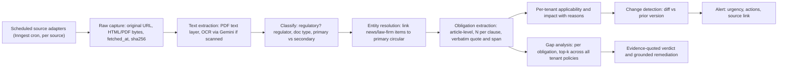
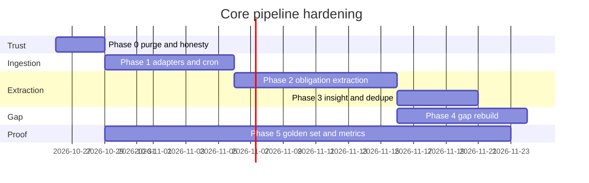

# Cogent Core Pipeline Audit — Horizon → Obligations → Gap Analysis

**Scope:** The moat pipeline only (Horizon Scanning, Obligation Mapping, Gap Analysis). No new features.
**Method:** Line-by-line read of the ingestion, extraction, applicability, and gap services, plus live probes of the source endpoints.

---

## 1. Verdict

What you saw over the last 6 days is not a tuning problem. The code is built to look live when it isn't, and that is why it feels the way it does:

| What you saw | Root cause in code |
|---|---|
| Same data for 5 days | **No scheduler exists.** Sync only runs when someone clicks it. The "Daily 06:00 WAT" label is hard-coded text. |
| Looks like fallback, not real | **5 of 8 sources always return hard-coded documents.** The other 3 fall back to hard-coded documents whenever the portal is slow. |
| Obligations I could write myself | The **body text of "live" CBN/SEC items is a template** the code writes itself, not the circular. Obligations are pulled from that template. |
| Gap analysis gives one action, or none | Each benchmark has about 2–3 template clauses, and **each clause gets exactly 1 regex-derived obligation.** |
| No clauses / no obligations | The real PDF is never downloaded. Clause splitting is regex over a short stub. |
| New alerts look like old ones | Every CBN item shares the same body text, fines, and rationale. News items about the same circular create duplicate alerts. |
| Can't trust it | Alerts come with **made-up comments ("Sam Johnson, 2 hours ago"), made-up audit logs, and made-up assignees.** |

> [!CAUTION]
> As it stands, the platform puts **made-up regulatory text, made-up circular reference numbers, and made-up ₦ penalties** in front of compliance officers. One bank examiner or GC who spots this is enough to end trust for good. Phase 0 below fixes this, and it has to happen before any user sees the product.

---

## 2. Evidence: Horizon Scanning

### 2.1 Nothing runs on a schedule
- The only caller of [syncAllLiveSources](file:///c:/Users/Alex%20Marco/Documents/Cogent/src/modules/radar/services/liveFeedCollector.ts#L75-L150) is `POST` [/api/radar/sync](file:///c:/Users/Alex%20Marco/Documents/Cogent/src/app/api/radar/sync/route.ts#L11-L36), which is user-triggered.
- There is no Inngest cron function and no Vercel cron (`vercel.json` has none).
- [GET /api/radar/sync](file:///c:/Users/Alex%20Marco/Documents/Cogent/src/app/api/radar/sync/route.ts#L50-L53) returns the hard-coded values `pollFrequency: 'Continuous / Daily 06:00 WAT'` and `status: 'OPERATIONAL'`.

### 2.2 Sources are mostly static
In [liveFeedCollector.ts](file:///c:/Users/Alex%20Marco/Documents/Cogent/src/modules/radar/services/liveFeedCollector.ts):

| Source | What actually happens |
|---|---|
| CBN (L185–297) | Calls the CBN list API but **never downloads the circular PDF**. It wraps title + description in a **made-up body** (L241–257: "2.1 All regulated entities must implement…", "₦10,000,000 … ₦500,000 daily"). Max 3 items per run. On failure it inserts a **made-up "contactless payments" circular** (L268–293). |
| SEC (L303–397) | Scrapes anchor tags. The ref code is a **hash of the title** (`SEC/CIR/1234`). Pub date = **today**. Body is **made up**. Fallback is a made-up VASP circular. |
| NDPC (L402–435) | Pings the portal, **ignores the response, and always returns the same 2024 hard-coded notice**. |
| ARCON (L440–468) | Same: one 2023 hard-coded item. |
| FCCPC (L473–504) | Same: one 2022 hard-coded item. |
| Law firms (L510–594) | Reads RSS and keeps only the description, then **adds made-up "advisory" text**. Labelled regulator = `CBN`. Fallback is a made-up Templars alert. |
| Nairametrics (L600–685) | Reads a general finance news feed. Every item is **labelled `SEC`** and gets made-up "Apex regulators have notified…" text. |
| Bank of Ghana (L691–722) | Always returns one hard-coded item. |

- The [sourceRegistry.ts](file:///c:/Users/Alex%20Marco/Documents/Cogent/src/modules/radar/services/sourceRegistry.ts) lists **18 sources, all `isActive: true`**. Only 8 are wired up, and the collector never reads the registry.

### 2.3 Ingestion design flaws ([circularIngestionService.ts](file:///c:/Users/Alex%20Marco/Documents/Cogent/src/modules/radar/services/circularIngestionService.ts))
- Feed items are passed as `text/plain` (L111–113), so the Gemini PDF extractor **never sees a real document**.
- The **original source URL is never stored**. `canonical_source_url` is set to the internal storage path (L337). Users can't click through to the regulator.
- Every ingested item is stamped `verification_status: 'HUMAN_VERIFIED'` (L340). **No human verified anything.**
- Ingestion runs inside a *user's* request using that user's RLS client, then loops over **all organizations** (L384) to write impacts. That is either cross-tenant leakage or silent failure.
- Notifications go to the hard-coded org `…0001` (L188).
- The tenant briefs are fixed strings (L421–424), e.g. "Evaluate balance sheet exposure and daily penalty provisions."

### 2.4 Feed presentation adds made-up data ([/api/radar/circulars](file:///c:/Users/Alex%20Marco/Documents/Cogent/src/app/api/radar/circulars/route.ts))
- Comments by **"Sam Johnson"** (L156–164), audit logs at a made-up **"Today 10:15 WAT"** (L166–170), and the assignee are on every alert.
- `topics` is the same array for every alert (L190).
- `severityMatrixCode` shows made-up percentages ("G1 | 89%") (L148).
- The feed is sorted by `created_at` (ingest time), not publication date. A 2022 FCCPC framework shows up as "new".
- The regulator is guessed from the ref prefix, defaulting to `CBN` (L59–63).

### 2.5 Why everything looks applicable and urgent
The made-up CBN body says "All licensed financial institutions, commercial banks, PSBs, switches, MMOs…" and "₦10,000,000". The metadata extractor therefore marks almost every item **universal + HIGH**, so the [ApplicabilityEngine](file:///c:/Users/Alex%20Marco/Documents/Cogent/src/modules/radar/services/applicabilityEngine.ts#L55-L63) says "applies to you" for every tenant. No relevance ranking exists.

---

## 3. Evidence: Obligation Mapping

[clauseSegmentationEngine.ts](file:///c:/Users/Alex%20Marco/Documents/Cogent/src/modules/radar/services/clauseSegmentationEngine.ts) is **entirely regex/keyword**:
- **Exactly one obligation per clause** (L382–400), even when a clause has five "shall" statements.
- The obligation "summary" is **the first sentence of the clause** (L370–374). Otherwise it's a template: "Mandatory statutory compliance requirement under…".
- The type is a keyword guess. Any clause containing "report", "file" or "inform" becomes `MANDATORY_DISCLOSURE`.
- **Penalties are made up when absent:** default ₦1M–₦5M, ₦10M–₦50M if "critical", daily fine = 2% (L324–354). The citation is a template: `"${regulator} Directive ${ref} / Statutory Enforcement"`.
- The target role comes from keywords. "pos" matches inside "purpose" and "position", which routes the obligation to the COO.
- Strategy 3 (L92–106) **always creates a clause**, even from a title alone. That is how you get alerts with a heading and nothing actionable.
- No applicability per obligation, no risk score against the tenant's framework, no verbatim span or page anchor.

The LLM is only used for PDF structure, and the live pipeline never sends it a PDF.

---

## 4. Evidence: Gap Analysis

[gapSynthesisService.ts](file:///c:/Users/Alex%20Marco/Documents/Cogent/src/modules/gap-matrix/services/gapSynthesisService.ts) and [concordanceEngine.ts](file:///c:/Users/Alex%20Marco/Documents/Cogent/src/modules/gap-matrix/services/concordanceEngine.ts):
- It compares **one policy against one document version's clauses**. Those clauses come from §3, so you get ~1–3 items. That is your "single action list".
- It only uses `obligations[0]` per clause (L121) and the **top-1 policy chunk** (`matchCount: 1`, L130). Coverage spread across sections is missed.
- **Results are matched up by position** (`synthesisOutput.items[i]`, L204). If the model reorders or drops an item, findings attach to the wrong obligation.
- When the vector RPC fails, [fallbackKeywordSearch](file:///c:/Users/Alex%20Marco/Documents/Cogent/src/modules/gap-matrix/services/policyVectorIndexService.ts#L178-L199) returns **the first N policy clauses with a made-up similarity of 0.5**. That produces random "Partially Met" results.
- `classifyComplianceTier` (L206–289) is **hard-coded to demo scenarios** (STR 72h, PEP, BVN, 5-year retention). It isn't a general method.
- If the model fails, a **template fallback** silently produces "The institution shall strictly enforce Section X…" with no flag in the UI (L421–472).
- The prompt asks the model for "historical Nigerian enforcement patterns and precedent sanctions" with no source material. **That invites made-up claims.**
- `issuingRegulator: 'CBN'` is hard-coded (L156, L177).
- If the benchmark id isn't a UUID, it attaches results to **an arbitrary `limit(1)` document version/clause** (L286–308). That corrupts the data.
- The benchmark seed corpus ([regulatoryCorpusData.ts](file:///c:/Users/Alex%20Marco/Documents/Cogent/src/shared/db/regulatoryCorpusData.ts)) is hand-written. Its clause text needs checking against official text.

---

## 5. What is solid and worth keeping

- The data model (`instruments → versions → clauses → obligations → penalties`, `policy_clauses` with pgvector, RLS, audit log hashing).
- Inngest is wired up (good base for cron and durable steps).
- The Gemini client with structured output, retries, and telemetry (`ai_analysis_runs`).
- The CBN list API approach (it's the right entry point; it just has to follow the PDF link).
- The policy upload → chunk → embed path.
- The UI shells (feed, detail, register, gap views). They only need honest data.

---

## 6. Target pipeline (what it must actually do)

**Non-negotiable rules:**
1. **Nothing made up, ever.** If a fetch fails, the source shows as *stale* with a timestamp. Nothing gets substituted.
2. **Every claim cites a source.** Every obligation, penalty, and gap verdict carries a verbatim quote plus the source URL, page, and section.
3. **Unknown means null.** No default penalties, deadlines, or roles.
4. **Provenance is visible:** `PRIMARY` (regulator), `SECONDARY` (law firm/news), `MANUAL` (uploaded). Secondary items link to their primary source or are labelled "unconfirmed".
5. **System jobs run as the system.** Ingestion uses a service-role client. Tenant fan-out is a separate step per org.

---

## 7. Remediation plan

### Phase 0: Stop the trust damage (2–3 days)
| # | Action | Files |
|---|---|---|
| 0.1 | Delete every hard-coded fallback document and made-up body template | `liveFeedCollector.ts` |
| 0.2 | Delete fake comments, audit logs, assignee, topics, and severity % from the feed API. Return empty arrays or real data only | `api/radar/circulars/route.ts` |
| 0.3 | Remove default penalties, template citations, and the Strategy-3 "always create a clause" path | `clauseSegmentationEngine.ts` |
| 0.4 | Remove the 0.5-similarity fake search and the `limit(1)` fallback attach. Make template fallback a visible "Analysis incomplete" state | gap services |
| 0.5 | Stop stamping `HUMAN_VERIFIED`. Use `MACHINE_EXTRACTED` and add a review state | ingestion service |
| 0.6 | **Clean the database:** delete radar circulars, clauses, obligations, impacts, and notifications built from made-up content (known refs: `PSM/DIR/CON/CWS/08/014`, `SEC/CIR/VASP/2026/009`, `NDPC/GDPR/CIR/2024/001`, `ARCON/VET/DIR/2023/004`, `FCCPC/DLR/2022/001`, `TEMPLARS/ADV/2026/001`, `TC/POLICY/2026/012`, `BOG/PSD/2025/11`, all `SEC/CIR/####` hash refs, all `NM/FIN/*`, `AO/ADV/*`) and check `scripts/seedRadarCirculars.ts` | one-off script |
| 0.7 | Mark unimplemented registry sources inactive. The UI shows only what is truly monitored | `sourceRegistry.ts` |

**Exit check:** a grep for hard-coded circular text returns nothing. The feed shows only items that trace back to a real URL.

### Phase 1: Real, continuous ingestion (1–1.5 weeks)
- **Focus source set (trust over breadth):** CBN circulars and press releases, SEC Nigeria, NDPC, FCCPC, NFIU, NDIC. Optional secondary feeds: 1–2 law-firm RSS and 1 news feed, as signals only.
- One **adapter per source**, behind one interface (`list() → fetchDocument() → extract()`), driven by the registry.
- **Inngest cron** per source (e.g. CBN every 2h, others every 6h), plus a per-tenant fan-out step.
- **Download the actual PDF/HTML.** Store the original bytes, the original URL, `published_at` from the source, and `fetched_at`.
- New `source_runs` table (source, started/finished, items_seen, new, errors, http status). This is what makes "real-time" provable.
- A **source health and freshness panel** in the UI: "CBN checked 14 min ago · last new item 2 days ago".
- **Reachability check needed:** from this machine, `cbn.gov.ng` and `ndpc.gov.ng` failed DNS resolution, `sec.gov.ng` timed out, `arcon.gov.ng` returned **403**, and `fccpc.gov.ng` returned 200. Some failures may be local network, but government portals are clearly flaky or block bots. Phase 1 must probe from Vercel `fra1` and may need a Nigeria-region fetch worker or proxy plus retry and backoff.
- Sort the CBN API list by `documentDate` desc and ingest **all** new items, not 3. Backfill the last 12 months once.

**Exit check:** 7 days of unattended runs. Every new official circular shows up within 2–6h, with a working source link.

### Phase 2: Real obligation extraction (1.5–2 weeks)
- Replace regex decomposition with **LLM structured extraction** (reasoning model) over the real document text, chunked by section:
  - **N obligations per clause**, each with: actor, action (modal verb), object, condition, deadline (verbatim), **verbatim quote + char span + page**, obligation type, penalty *only if stated in the text*, confidence.
  - Validate in code: the quote must exist in the source text exactly; otherwise drop the obligation or send it for review.
- Works for **articles and secondary sources** too. Extract "reported obligations" and label them secondary until linked to the primary circular.
- **Per-obligation applicability** against the tenant profile (licences, rails, products, size), with a stated reason.
- **Risk score** = severity × applicability × proximity of deadline, using the tenant's risk weights.
- A review queue for low-confidence extractions (an internal analyst can approve them during beta).
- Change detection: when a new version supersedes an old one, show an obligation-level diff (added, removed, changed).

**Exit check:** on a hand-labelled golden set (§8), recall ≥ 85% and precision ≥ 90% for obligations, with 0 obligations whose quote isn't in the source.

### Phase 3: Insight that saves time (1 week)
- Alert brief is generated **from the extracted obligations**, not free text: what changed, who it applies to and why, deadline, top 3 actions, source link.
- Role briefs only for roles the obligations actually touch. No fixed CFO/CTO templates.
- Dedupe and cluster: one alert per primary circular, with linked commentary ("Templars and Nairametrics covered this").
- Relevance-ranked feed per tenant. "Not applicable" items are collapsed, not mixed in.

### Phase 4: Gap analysis rebuild (1.5 weeks)
- **Start from obligations, not clauses:** analyse *all applicable obligations* (from one or more instruments) against *all of the tenant's policies*.
- Retrieval: hybrid (pgvector + full-text) **top-k = 5 across all policy documents**. No fake fallback; fail loudly.
- An LLM judge per obligation (batched), keyed by **obligation ID, not position**. Output: status, **verbatim policy evidence quote(s)**, missing elements (e.g. "timeline 7 days vs required 72h"), and confidence. Validate quotes against the policy text.
- Remediation drafts are grounded in the obligation's verbatim text and the tenant's existing policy style. No invented enforcement history.
- A coverage report: X obligations assessed, Y met / Z partial / W gap, with each verdict expandable to show both quotes side by side.
- Remove the hard-coded demo heuristics in `classifyComplianceTier`.

**Exit check:** on 3 real sample policies (one good, one weak, one missing sections), verdicts match a compliance expert's review on ≥ 85% of obligations.

### Phase 5: Prove it (runs alongside, then gates the beta)
- **Golden set:** 25–30 real circulars (CBN, SEC, NDPC, FCCPC, NFIU) with hand-labelled obligations. Run in CI on every change to prompts or extraction.
- **Metrics dashboard (internal):** source freshness, time from publication to alert, extraction precision and recall, share of items needing review, gap-verdict agreement, and the model fallback rate.
- **Time-to-value script:** a new tenant onboards, then within 10 minutes sees a ranked feed of the last 90 days of applicable circulars, a full obligation register, and a first gap run on an uploaded policy.

---

## 8. Marketing claims vs current reality

| Claim | Status today | What makes it true |
|---|---|---|
| "Real-time / always-on monitoring" | ❌ Manual button, static data | Phase 1 cron + freshness panel |
| "Extract all applicable obligations… article-level" | ❌ 1 regex obligation per clause | Phase 2 |
| "Up to +90% accuracy" | ❌ Never measured | Phase 5 golden set. **Don't publish a number until it's measured.** |
| "Side-by-side highlighted change comparisons" | ⚠️ UI exists, no real version diffs | Phase 2 change detection |
| "Gap detection in seconds" with tailored fixes | ⚠️ Fast, but shallow and partly template | Phase 4 |
| "Full audit trails and source links" | ❌ No original source URL stored, fake audit entries | Phases 0 and 1 |
| "Any jurisdiction, any language" | ❌ | Drop for the Nigeria beta |

> [!NOTE]
> Per the design rules in `AGENTS.md`, customer-facing UI copy must not say "AI agents" or "AI-powered", even though the marketing site might. Use "Statutory Concordance Analysis" and similar wording.

---

## 9. Suggested order and timeline

About **5–6 weeks** to a beta you can defend. Phase 0 alone makes the product honest within days.

---

## 10. Decisions needed from you

1. **Source set for beta:** OK to cut to CBN, SEC, NDPC, FCCPC, NFIU, NDIC (primary) + 2 secondary feeds, and drop Ghana, Kenya, South Africa, WAEMU and GIABA for now?
2. **Database purge:** OK to delete all existing radar circulars and derived rows built from made-up content, then backfill 12 months from real sources?
3. **Human review during beta:** will someone on your side review low-confidence obligations (a few minutes a day)? This is the fastest route to trustworthy output.
4. **Fetch infrastructure:** if Nigerian government portals block or time out from Vercel `fra1`, are you open to a small Nigeria-region fetch worker or proxy?
5. **Golden set:** can you or a compliance contact hand-label obligations for ~25 real circulars? That is what lets us state an accuracy number honestly.
